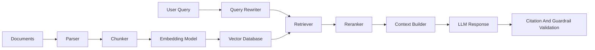

# RAG Knowledge Assistant

Production-style Retrieval-Augmented Generation assistant with document ingestion, chunking, embeddings, vector search, citations, reranking, evaluation, and API deployment.

This repository is built for portfolio demonstration using public or synthetic documents only.

## What This Demonstrates

- End-to-end RAG pipeline design
- Document ingestion and chunking strategy
- Embedding generation and vector search
- Citation-grounded responses
- Retrieval quality evaluation
- FastAPI deployment pattern
- Hallucination checks and response validation

## Architecture



## Features

- Configurable chunk size and overlap
- Metadata-aware indexing
- Semantic search with FAISS or Chroma
- Optional reranking stage
- Citation formatting
- Retrieval evaluation examples
- REST API endpoint for question answering

## Tech Stack

- Python
- LlamaIndex
- LangChain
- FAISS or Chroma
- FastAPI
- Pydantic
- OpenAI or Azure OpenAI compatible interface

## Suggested Repository Topics

`rag`, `llamaindex`, `langchain`, `vector-database`, `faiss`, `chroma`, `semantic-search`, `fastapi`, `llm-evaluation`

## Quickstart

```bash
python -m venv .venv
.venv\Scripts\activate
pip install -r requirements.txt
python ingest.py
python app.py
```

## Example Output

```json
{
  "question": "What are the key system components?",
  "answer": "The system includes ingestion, chunking, embedding, retrieval, reranking, and response validation.",
  "citations": [
    {
      "document": "architecture_notes.md",
      "chunk_id": "chunk_004"
    }
  ],
  "retrieval_metrics": {
    "top_k": 5,
    "citation_coverage": 1.0
  }
}
```

## Evaluation

- Recall at K
- Citation coverage
- Context relevance score
- Answer faithfulness
- Latency by stage
- Cost per request

## Responsible AI And Security

- Keeps generated answers grounded in retrieved context
- Returns citations for claims
- Separates secrets through environment variables
- Avoids storing sensitive documents in the repository

## Recruiter Signal

This project directly demonstrates RAG, LlamaIndex, embeddings, vector databases, semantic retrieval, evaluation, and production API design.

