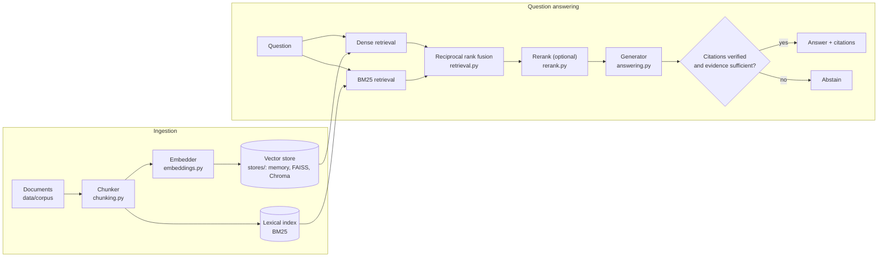
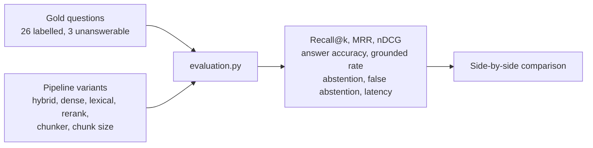

# Architecture and use cases

## System overview

Documents are chunked, embedded and stored once. Every question then runs
through hybrid retrieval, optional reranking and grounded answering. The answer
is checked against the evidence before it is returned, and the system abstains
when the corpus cannot support one.

## Evaluation loop

Every configuration choice is measured against a labelled gold set, so a change
is accepted on evidence.

## Components

| Module | Responsibility |
|---|---|
| `types.py` | `Document`, `Chunk`, `ScoredChunk`, `Citation`, `Answer` |
| `chunking.py` | Fixed, sentence, section and paragraph strategies. Each chunk keeps its heading and source offsets |
| `embeddings.py` | Hashing, TF-IDF, and a sentence-transformers adapter |
| `retrieval.py` | BM25, dense search and reciprocal rank fusion |
| `rerank.py` | Lexical, MMR and cross-encoder rerankers, composable |
| `answering.py` | Extractive, template or model generation, plus citation verification |
| `evaluation.py` | Metrics, gold sets and side-by-side comparison |
| `pipeline.py` | `RAGPipeline`: `add_documents`, `retrieve`, `ask`, `stats` |
| `stores/` | A shared interface with in-memory (exact), FAISS and Chroma backends |
| `cli.py` | `ask`, `search`, `eval`, `compare`, `chunks`, `stats` |

## Use cases

| Use case | Who | How it helps |
|---|---|---|
| Answer questions over internal policies, runbooks or help docs | Support or operations team | Answers carry citations to the exact chunk and character span |
| Avoid confident wrong answers | Anyone running a customer-facing assistant | It abstains when evidence is thin instead of guessing |
| Find exact identifiers such as error codes or SKUs | Engineers and support | BM25 catches exact tokens that dense search misses, and fusion keeps both |
| Find the right document when wording differs | End users | Dense retrieval matches "get my money back" to the refund policy |
| Decide whether reranking or a new chunker is worth it | ML engineer | `compare` produces a side-by-side table, and here reranking measurably hurts so it ships off |
| Swap in FAISS or Chroma without changing code | Platform engineer | Stores share an interface and are comparable on the same gold set |
| Restrict search to one document set | Multi-tenant or permissioned apps | Metadata filtering limits results to chosen sources |
| Regression-test a RAG change in CI | Developer | The gold-set evaluation gives a repeatable score to gate on |
